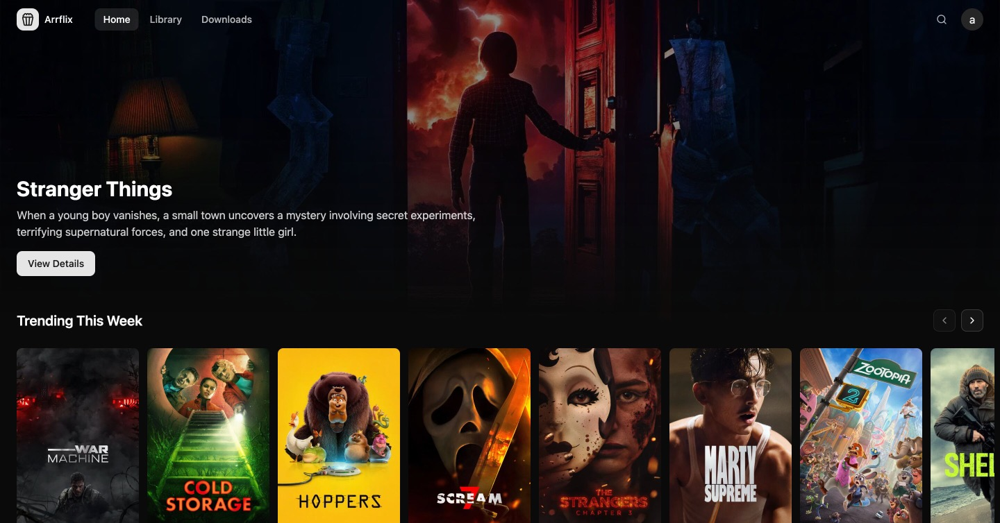

# Arrflix

Arrflix is a self-hosted media manager for movies and series. Browse, search, download, and organize your library from a single app.



## Features

- **Single container.** One Docker image, one compose file. No juggling multiple \*arr apps.
- **Movies and series.** Manage both from a single UI instead of separate Sonarr/Radarr instances.
- **Requests and monitoring.** Friends request titles; Arrflix finds the best release for your quality profile, downloads it, and tells them it's ready.
- **Routing rules.** Route content to different libraries, downloaders, or naming templates based on rules you define.
- **Built-in indexer support.** Prowlarr is bundled and managed automatically.
- **Name templates.** Control exactly how files are renamed and organized on import.
- **Hardlink-first imports.** Downloaded files are hardlinked into your library to save disk space.

## Project Status

Arrflix is under active development and usable today for requests, automatic and manual downloads, and library management.

**What works well:**

- Searching indexers and downloading releases
- Importing completed downloads with custom naming
- Library scanning and TMDB metadata matching
- Multi-library and multi-downloader setups via routing rules
- Monitoring and automatic release selection with quality profiles
- Requests with auto-approval or an approval queue, plus in-app, email, and push notifications

**What’s still on the roadmap:** see the [Roadmap](https://kyleaupton.github.io/arrflix/guide/roadmap.html).

This is early adopter software. The core workflows are solid, but you may encounter rough edges. Breaking changes are possible between releases. Feedback and bug reports are welcome.

## Quick Start

Full documentation is available at **https://kyleaupton.github.io/arrflix/**

Start with the [Introduction](https://kyleaupton.github.io/arrflix/guide/introduction.html), then follow the [Getting Started](https://kyleaupton.github.io/arrflix/guide/getting-started.html) guide.

## Development Setup

### Requirements

- Docker & Docker Compose
- A TMDB API key

### Local Development

1. Clone the repository:

   ```bash
   git clone https://github.com/kyleaupton/arrflix.git
   cd arrflix
   ```

2. Create a `.env` file:

   ```env
   MEDIA_LIBRARIES=/path/to/test/media
   ```

3. Start the development stack:
   ```bash
   just up
   ```

The backend, frontend, database, and supporting services all run together in one dev container (`docker compose up` works too). The app is at http://localhost:8484. Run `just` to list the other dev tasks.

## Contributing

Arrflix is a solo project that welcomes community involvement. Bug reports, feature suggestions, and discussions are encouraged via [Issues](https://github.com/kyleaupton/arrflix/issues).

Pull requests are welcome, though larger changes should be discussed first to make sure they align with the project’s direction.

## License

GPL-3.0

## Third-Party Software

This project bundles the following third-party software, each distributed under its own license:

- [Prowlarr](https://github.com/Prowlarr/Prowlarr) — GPL-3.0
