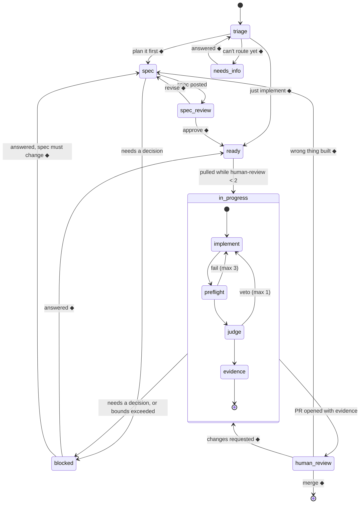

# Factory workflow

How Arrflix work moves from an issue to a merged PR when agents do the building. GitHub Issues is the tracker, and labels are the states. Humans decide what gets built, approve what's built, and merge. Agents do the work in between.

**Review attention is the scarce resource.** Gates exist only where human judgment can't be replaced, and the factory pulls new work only as fast as it can be reviewed.

## States



◆ = human gate. The orchestrator never moves an issue out of a gated state. The states nested inside `in_progress` are steps of one run, not labels.

Every factory issue starts at `factory:triage`. Outside issues never enter this diagram; see [Issue sources](#issue-sources).

| Label | Meaning | Who moves it out |
| --- | --- | --- |
| `needs-triage` | A community issue, not yet reviewed by a maintainer. Set by the issue templates. Not in the factory. | Maintainer |
| `needs-info` | Waiting on more information before it can be routed. Used on community issues and factory issues alike. | Maintainer |
| `factory:triage` | The start of the factory flow. A factory issue waits here for a maintainer to choose its route. | Maintainer |
| `factory:spec` | An agent drafts a per-ticket spec and posts it as an issue comment. | Orchestrator |
| `factory:spec-review` | The spec waits for approval. | Maintainer |
| `factory:ready` | Specified and approved; waiting to be pulled. | Orchestrator |
| `factory:in-progress` | One run is in flight. Doubles as the claim: an issue carrying it is never pulled twice. | Orchestrator |
| `factory:human-review` | A PR is open with evidence attached. | Maintainer |
| `factory:blocked` | An agent stopped on a decision and wrote down the question. | Maintainer |
| `decision` | Marks an issue whose outcome is a product decision, not code. Outside the flow. | Maintainer |

## Issue sources

The factory works only from issues a maintainer or the bot wrote.

| Source | Author | Starts at |
| --- | --- | --- |
| A maintainer's own idea or brainstorm | The maintainer, after approving the draft locally | `factory:triage` |
| A community report | The reporter | `needs-triage`. It stays a normal issue. |
| Acting on a community report | The maintainer, as a new issue linking the report | `factory:triage` |
| Work the factory finds during a run | The bot | `factory:triage`. The factory suggests work but never routes it. |

### Community issues

**No agent ever acts on a community issue's thread.** Agents don't comment on it, label it or reply to it. A maintainer triages it by hand, and asks for missing information themselves (`needs-info`).

To help with that, a summary agent reads each `needs-triage` issue **as data** and reports **privately to the maintainer**, never on GitHub. The summary says what the report is, whether it duplicates another issue or is already fixed, what information is missing, and what it suggests doing. The agent has no GitHub write access and no secrets, so the worst a hostile report can produce is a bad suggestion the maintainer ignores. It's the only agent that reads outside text.

**Acting on a report means writing a new issue,** not labeling the report. The new issue states what is actually being fixed, in the maintainer's words, since a report often turns out to have a different root cause or to be two bugs. It starts at `factory:triage` like any other factory issue. The maintainer leaves a one-line comment on the report ("tracking in #N"). The PR closes both with `Fixes #<factory issue>, fixes #<report>`, so the reporter is notified once, when it's fixed.

This keeps reporter text out of every agent's context as a ticket, and keeps `factory:` labels and bot comments off community threads.

### What a factory issue says

A factory issue is the input to triage, not a plan. It states the problem, who it affects and what they experience, any decisions already made, and acceptance criteria when they're known. It doesn't prescribe files or functions: the plan comes from the spec stage, written against the code as it is when the issue is pulled.

## Gates

1. **Triage** (`factory:triage`). The maintainer chooses the route, by one question: *could I review the PR without first agreeing on an approach?*
   - **Yes → `factory:ready`.** What to build is clear, and no product, UI or copy choice is left. The issue is its own spec.
   - **No → `factory:spec`.** There's a design choice, new UI or copy, or an undecided question.
   - **Can't tell yet → `needs-info`**, with the missing piece written down. It returns to `factory:triage` once answered.

   When in doubt, choose spec: an unneeded spec costs minutes to read, and a PR that built the wrong thing costs a review and a redo.
2. **Spec review.** Where product meets engineering, and the cheapest place to catch a wrong decision. The spec is an issue comment; approving it means applying `factory:ready`.
3. **Merge.** Branch protection on `main` requires a maintainer's approving review, so the bot can open PRs but never merge them.

### Producing a spec

`factory:spec` requires only that a spec comment exists before the issue moves to `factory:spec-review`. There are two ways to produce one:

- **Headless:** the orchestrator runs a spec agent and posts its draft as the bot. This suits medium tickets, or any ticket where a strawman to react to helps.
- **Interactive:** a maintainer works the spec out in a private agent session, with the issue loaded via `gh issue view <n> --comments`, and posts the result themselves. This is the default for large or ambiguous tickets.

Either way, **the spec comment records decisions and their reasons, not the conversation that reached them.** The working-out stays private. Session transcripts are kept on the factory host, never posted, because what a maintainer had to ask shows what context the spec agent lacked, and that feeds the improvement loop.

Who posted a spec shows how it was made: the bot posts what the factory produced unattended, and a maintainer posts what they decided.

`factory:blocked` is the escape hatch. An agent that reaches a real decision stops and states the question. It doesn't guess.

## A run

A run is one issue moving through `factory:in-progress`. It alternates deterministic steps, which always execute, with agent steps, whose retries are bounded:

| Step | Kind | Does |
| --- | --- | --- |
| Workspace | deterministic | Creates a git worktree on branch `factory/<issue>-<slug>` and a dev stack with its own container name and port (see "Running a second dev stack" in `.claude/rules/workflow.md`). |
| Implement | agent | Builds the ticket and writes a test named for each REQ it closes. |
| Preflight | deterministic | Runs `just preflight`. A failure goes back to Implement, at most 3 times. |
| Judge | agent, fresh context | Rules on the diff against the ticket: is everything inside scope, and does each REQ test assert its requirement? A veto goes back to Implement once. |
| Evidence | deterministic | Captures screenshots of touched screens at desktop and mobile widths, and lists the REQ tests that pass. |
| Submit | deterministic | Pushes the branch and opens the PR with the judge's summary and the evidence. |

Exceeding a retry bound ends the run in `factory:blocked`, with the last failure as the question.

**Each agent step gets its own context, assembled by the orchestrator:**

- **Implement:** the issue, the approved spec comment, the human review comments when the PR is reworked, and the repo's rules.
- **Judge:** the diff, the issue, the spec, and the REQ text. Never the implementer's reasoning or transcript.
- **Spec:** the issue, `specs/V1.md`, and the owning module spec.

No session carries over between steps. Stages share only the artifacts they leave: the spec comment, the PR, and the run log.

## Writes

Agents in a run never hold GitHub write access. An interactive session doesn't count as a run: it's the maintainer acting, with their own credentials. A run returns a result, and only the orchestrator applies it, using the GitHub App's token:

```json
{
  "outcome": "pr_opened | blocked",
  "question": "only when blocked",
  "summary": "what was built, in a paragraph",
  "retries": { "preflight": 0, "judge": 0 },
  "evidence": ["paths to screenshots and test reports"],
  "tokens": 0
}
```

The orchestrator validates the result before applying any transition, so the gate rules live in code, not in prompts. It records every transition two ways:

- In one status comment per issue, which the bot edits in place.
- As a line in a JSONL log on the factory host.

Discussion of the code happens in the PR.

## Limits

| Limit | Value |
| --- | --- |
| Open `factory:human-review` PRs before the orchestrator stops pulling from `ready` | 2 |
| Concurrent runs | 1 |
| Preflight fix attempts per run | 3 |
| Judge vetoes per run | 1 |

Raise the review limit only when the factory is waiting on the maintainer, not the other way round.

## Rework

- **Changes requested** at human review sends the issue back to `factory:in-progress` on the same branch. The review comments go to Implement as input.
- **Wrong thing built** sends it back to `factory:spec`. The PR is closed.

A maintainer's review comments are the factory's best training signal. The improvement loop reads them, along with blocked questions and retry counts, and opens PRs against the rules and skills.

## Orchestrator

A polling daemon on the factory host. Every cycle it reconciles the labels it observes against the work it should be doing. There's no webhook endpoint, and a restart loses nothing.

It acts on an issue only when both of these checks pass, read from the issue's timeline:

- The issue's author is on the allowlist: the maintainers and the bot.
- The current `factory:` label was applied by a maintainer or by the orchestrator itself.

Anything else is skipped and logged. Community issues fail the first check by construction, so the orchestrator never acts on them; only the summary agent reads them, and its output goes to the maintainer alone. This check is the trust boundary, so it lives in code. A prompt telling agents to distrust outside text is a second layer, not a substitute.

It doesn't run on a self-hosted Actions runner. On a public repo, fork PRs could execute code on the host.

This file is Arrflix's per-project configuration. The generic machinery (polling, workspaces, writes) lives outside this repo.

## Manual phase

Until the orchestrator exists, a maintainer plays it. They apply the same labels by hand, run each agent step headless in a fresh session with the context listed above, and keep a log per ticket:

- the states the ticket went through
- each intervention, tagged `missing-context`, `wrong-decision`, `verification-gap` or `taste`
- retries and bounces
- evidence they wanted at review and didn't have

After 10–15 tickets, the log decides which steps and gates earn their place, and it becomes the improvement loop's first data.

## Later

- **Earned autonomy:** a ticket type that keeps merging unchanged may skip spec review.
- **Holdouts:** acceptance checks the implementer never sees, kept outside the worktree. The stories' "Must be true" sections are in the repo, so they don't qualify as-is.
- **A quality reviewer** alongside the judge, if the intervention log shows quality problems `just preflight` and the rules miss.
- **A generated diagram:** once states live in the orchestrator's definition, generate the Mermaid above from it and check for drift in CI.
