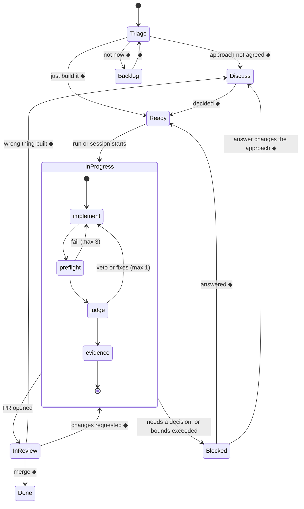

# Factory workflow

How Arrflix work moves from an issue to a merged PR. A private Linear workspace (team **ARFX**) is the tracker, and its statuses are the states. Humans decide what gets built, approve what's built, and merge. Agents do the work in between, either headless in the factory or interactively with a maintainer.

**Review attention is the scarce resource.** Gates exist only where human judgment can't be replaced, and the factory pulls new work only as fast as it can be reviewed.

## Two ways to build

The factory fits work whose outcome is clear, that a test can prove, and whose fix can be found in the code. Work that is mostly deciding *what* to do (a design choice, new UI or copy, a new testing surface) is better worked out in conversation between a maintainer and an agent. That conversation is the spec.

- **Headless:** a Ready issue labelled `factory`. A run builds it and opens a PR as the bot.
- **Interactive:** any other Ready issue. A maintainer builds it with an agent in a session, with their own credentials.

Both end in a PR the maintainer reviews and merges. An issue can start in Discuss, get settled in conversation, and still go to the factory.

## States

◆ = human gate. The orchestrator never moves an issue out of a gated state. The states nested inside In Progress are the steps of a headless run.

| Status | Meaning | Who moves it out |
| --- | --- | --- |
| Triage | New, waiting for a maintainer to route it. | Maintainer |
| Backlog | Worth doing, not now. | Maintainer |
| Discuss | Needs a conversation before it's buildable. | Maintainer |
| Ready | Agreed and buildable. With the `factory` label, the factory may pull it. | Orchestrator, or the maintainer starting a session |
| In Progress | One run or session is building it. Doubles as the claim: an issue In Progress is never pulled twice. | Orchestrator |
| Blocked | An agent stopped on a decision and wrote down the question. | Maintainer |
| In Review | A PR is open. | Maintainer |
| Done, Canceled, Duplicate | Finished. A merge moves the issue to Done. | |

Labels:

| Label | Meaning |
| --- | --- |
| `factory` | A Ready issue the headless factory builds. The only label a run reads. |
| `Test` | Adds tests that pin behavior that already holds; no production change. |
| `github` | Came from an outside GitHub issue, which the description links. |
| `Bug`, `Feature`, `Improvement` | The kind of change. |

V1's issues belong to the **V1** project, with one milestone per section of `specs/V1.md`.

## Issue sources

| Source | Written by | Starts at |
| --- | --- | --- |
| A maintainer's own idea, or the outcome of a discussion | The maintainer, or an agent on their behalf in a session | Triage, or straight to Ready or Discuss when the conversation already routed it |
| An outside report on GitHub | The reporter, on GitHub | Not in Linear. See below. |
| Acting on an outside report | The maintainer, as a Linear issue labelled `github` that links the report | Triage |
| Work the factory finds during a run | The orchestrator, from the run's `followups` | Triage. The factory suggests work but never routes it. |

### Outside reports

GitHub Issues stay open for people outside the project. **No agent acts on a GitHub issue's thread:** agents don't comment on it, label it or reply to it.

**Acting on a report means writing a new Linear issue**, not copying the report. The new issue states what is actually being fixed, in the maintainer's words, since a report often turns out to have a different root cause or to be two bugs. The PR says `Fixes ARFX-<n>, fixes #<report>`, so the reporter is notified once, when it's fixed.

This keeps reporter text out of every agent's context as a ticket. Linear is private, so everything in it was written by a maintainer or by the factory, and a run needs no author check.

### What a factory issue says

A factory issue is the input to a run, not a plan. It states the problem, who it affects and what they experience, any decisions already made, the REQ IDs it covers, and acceptance criteria. It doesn't prescribe files or functions: the implementer reads the code as it is when the run starts.

## Gates

1. **Triage.** The maintainer routes the issue by one question: *could I review the PR without first agreeing on an approach?*
   - **Yes → Ready.** What to build is clear, and no product, UI or copy choice is left. The issue is its own spec. Add `factory` if a run should build it.
   - **No → Discuss.** There's a design choice, new UI or copy, or an undecided question.

   When in doubt, choose Discuss: an unneeded conversation costs minutes, and a PR that built the wrong thing costs a review and a redo.
2. **Discuss.** Where product meets engineering, and the cheapest place to catch a wrong decision. The maintainer works it out with an agent in a session. When a factory run will build it, the outcome is posted as a comment on the issue that opens with a `## Spec` heading; the latest such comment is the spec a run reads. Then the issue moves to Ready.
3. **Merge.** The bot can open PRs but never merge them.

**The spec comment records decisions and their reasons, not the conversation that reached them.** The working-out stays private.

Blocked is the escape hatch. An agent that reaches a real decision stops and states the question. It doesn't guess. The question goes on the issue, and the answer is a reply there, so the decision is recorded where the next run reads it.

## A run

A run is one `factory` issue moving through In Progress. It alternates deterministic steps, which always execute, with agent steps, whose retries are bounded:

| Step | Kind | Does |
| --- | --- | --- |
| Workspace | deterministic | Makes a self-contained clone of GitHub's `main` on branch `factory/<Linear's branch name>`, e.g. `factory/arfx-12-pin-search`, and starts a sandbox on it (see [Sandbox](#sandbox)). A git worktree won't do: its `.git` points outside the mount. |
| Implement | agent | Builds the ticket and writes a test named for each REQ it closes. |
| Preflight | deterministic | Runs `just preflight-all` (preflight plus the integration suite, where most REQ tests live). A failure goes back to Implement, at most 3 times. |
| Judge | agent, fresh context | Rules on the diff against the ticket: is everything inside scope, does each REQ test assert its requirement, is each acceptance criterion met, and does the change bring in a defect? A veto goes back to Implement once. So do `fix` findings: not wrong, but cheap and clearly right, the kind a maintainer would ask for before merging. A veto and fixes share that one rework. |
| Evidence | deterministic | Captures screenshots of touched screens at desktop and mobile widths, and lists the REQ tests that pass. |
| Submit | deterministic | Commits the tree as the bot, using the implementer's `commit_message`, pushes the branch, and opens the PR with the implementer's summary, the judge's summary and the evidence. Agents never commit. |

Exceeding a retry bound ends the run in Blocked, with the last failure as the question.

The prompts are `factory/prompts/implement.md` and `factory/prompts/judge.md`.

**Each agent step gets its own context, assembled by the orchestrator:**

- **Implement:** the issue, the spec comment, the human review comments when the PR is reworked, and the repo's rules.
- **Judge:** the diff, the issue, the spec, and the REQ text. Never the implementer's reasoning or transcript.

No session carries over between steps. Stages share only the artifacts they leave: the spec comment, the PR, and the run log.

## Sandbox

Every agent step runs inside a sandbox: a container from the `factory` target of `docker/Dockerfile.dev`, started by `factory/bin/sandbox`. It is the dev image (Go, Node, Postgres and the app under s6) plus `just`, git and the Claude CLI. A run's clone is bind-mounted at `/app`, and the dev services run it, so the app is available for screenshots.

**The container is the trust boundary.** It gets the clone and the Claude credentials, and nothing else from the host: no docker socket, no home directory, no GitHub credentials. Inside it, `just` runs commands directly (`ARRFLIX_IN_CONTAINER=1`), and the integration tests use the container's own ephemeral Postgres (`ARRFLIX_TEST_PG_DSN`) instead of testcontainers.

Commands run as the caller's uid with a throwaway `HOME`, so no Claude config, memory or settings exist except what the repo holds. Each agent step gets its own `HOME`, deleted when the step ends, so the judge can't read the implementer's session. Agents run with full permissions inside the sandbox: the container is the boundary, and an allowlist behind it would add friction without adding safety.

`factory/bin/run-stage <step> <issue>` runs one step of a run:

- `implement` and `judge` are the agent steps. Each reads the issue from Linear on the host, refuses an issue that isn't labelled `factory` or isn't in the right status, makes the run's clone and sandbox on first use, and prints the step's structured result. `implement` moves a Ready issue to In Progress. On a rework, it reads the latest "request changes" review on the PR. When the implementer returns `blocked`, `implement` posts its question as a comment opening with `## Blocked` and moves the issue to Blocked. The maintainer answers in comments and moves the issue to Ready, and the next `implement` resumes with every comment after the question as its feedback.
- `submit` is the Submit step, on the host. It commits the tree as the bot, pushes the branch, opens the PR (or comments the rework's results on it) and moves the issue to In Review. It refuses work the judge hasn't passed.
- `watch` follows a running agent step's tool calls and messages.
- `done` cleans up once the issue is Done or Canceled. It removes the sandbox and deletes the clone, and keeps the logs.

A run's branch starts from GitHub's `main`, not the local checkout's, because that's what its PR targets.

`factory/bin/req-coverage` is V1's progress report. It lists each REQ ID under _In_ in `specs/V1.md`, marks the ones with a test named for them (a Go `TestReq…` function or a web test titled `REQ-…: …`), and shows the rest with their story's *currently true* status. `--missing` lists only the uncovered ones.

Runs live outside the repo, under `~/.local/share/arrflix-factory/runs/<issue>/` (e.g. `runs/ARFX-12/`), with each step's prompt, result and transcript in `logs/`.

`factory/bin/linear` reads an issue from Linear, moves it between statuses and comments on it, with the API key in `~/.config/arrflix-factory/env`. That key is the maintainer's for now, so the factory's status moves show as theirs; a Linear app with its own identity can replace it.

`factory/bin/gh-bot` is `gh` acting as the factory's GitHub App, `arrflix-factory-bot`. It mints an installation token, valid for an hour, from the App's private key, which stays on the factory host (`~/.config/arrflix-factory/bot.pem`) and is never mounted into a sandbox. The App can write contents, pull requests and issues, but not workflows, so nothing the factory pushes can change CI.

A manual run and an orchestrated run differ only in who calls `run-stage`.

## Writes

Agents in a run never hold GitHub or Linear credentials, and never commit. An interactive session doesn't count as a run: it's the maintainer acting, with their own credentials. Each agent step returns a structured result, and only the orchestrator applies it, with the GitHub App's token and the Linear key:

| Step | Schema | Outcomes |
| --- | --- | --- |
| Implement | `factory/schemas/implement-result.json` | `implemented`, `blocked` (with a question), `no_change` (the behavior already holds) |
| Judge | `factory/schemas/judge-result.json` | `pass` (with any `fix` findings), `veto` (with blocking findings) |

Besides the outcome, the implementer reports out-of-scope problems it left alone (`followups`, which may become Triage issues), gate failures in code it didn't touch (`unrelated_failures`), and anything the sandbox lacked (`needed`, which decides what the factory image gains). Retry counts, cost and tokens come from the orchestrator and the CLI, not from the agent.

The orchestrator validates the result before applying any transition, so the gate rules live in code, not in prompts. It records every transition two ways:

- In one status comment per Linear issue, which the orchestrator edits in place.
- As a line in a JSONL log on the factory host.

Discussion of the code happens in the PR.

## Limits

| Limit | Value |
| --- | --- |
| Issues In Review before the orchestrator stops pulling from Ready | 2 |
| Concurrent runs | 1 |
| Preflight fix attempts per run | 3 |
| Judge reworks per run (veto or fixes) | 1 |

Raise the review limit only when the factory is waiting on the maintainer, not the other way round.

## Rework

- **Changes requested** at human review sends the issue back to In Progress on the same branch. The review comments go to Implement as input.
- **Wrong thing built** sends it back to Discuss. The PR is closed.

A maintainer's review comments are the factory's best training signal. The improvement loop reads them, along with blocked questions and retry counts, and opens PRs against the rules and skills.

## Orchestrator

A polling daemon on the factory host. Every cycle it reconciles the Linear statuses it observes against the work it should be doing. There's no webhook endpoint, and a restart loses nothing.

It pulls only Ready issues labelled `factory`, from the private ARFX team. Nothing from outside the project reaches Linear except through a maintainer, so the tracker itself is the trust boundary. A prompt telling agents to distrust outside text is a second layer, not a substitute.

It doesn't run on a self-hosted Actions runner. On a public repo, fork PRs could execute code on the host.

This file is Arrflix's per-project configuration. The generic machinery (polling, workspaces, writes) lives outside this repo.

## Manual phase

Until the orchestrator exists, a maintainer plays it. They route issues by hand, run each step with `factory/bin/run-stage`, review the bot's PR on GitHub, run `run-stage done` after merging, and keep a log per ticket:

- the states the ticket went through
- each intervention, tagged `missing-context`, `wrong-decision`, `verification-gap` or `taste`
- retries and bounces
- evidence they wanted at review and didn't have

After 10–15 tickets, the log decides which steps and gates earn their place, and it becomes the improvement loop's first data.

## Later

- **Earned autonomy:** a ticket type that keeps merging unchanged may skip Triage.
- **A headless spec agent** that drafts a `## Spec` comment for a Discuss issue, as a strawman to react to.
- **A GitHub triage agent** that reads outside reports as data and suggests Linear Triage issues to the maintainer, privately. It would have no write access to GitHub, so the worst a hostile report could produce is a bad suggestion.
- **A Linear app identity** for the orchestrator, so its moves and comments show as the factory's, not the maintainer's.
- **Holdouts:** acceptance checks the implementer never sees, kept outside the worktree. The stories' "Must be true" sections are in the repo, so they don't qualify as-is.
- **A quality reviewer** alongside the judge, if the intervention log shows quality problems `just preflight` and the rules miss.
- **A generated diagram:** once states live in the orchestrator's definition, generate the Mermaid above from it and check for drift in CI.
